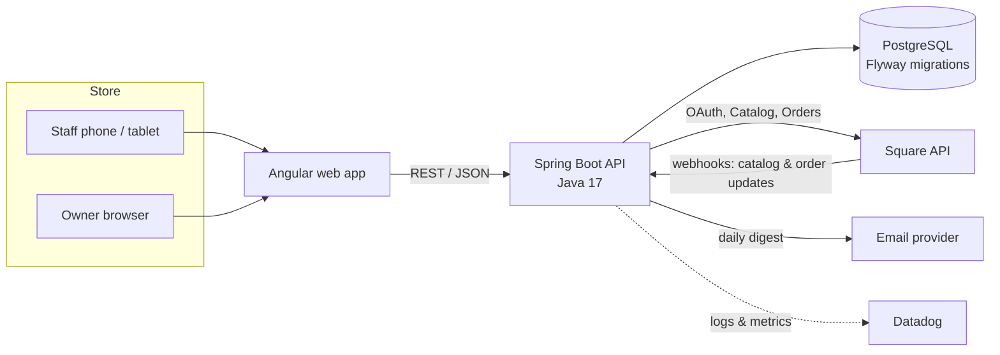
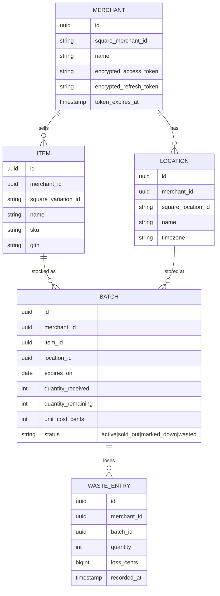

# ShelfLife: product and engineering plan

> Working name. Check the name and domain before launch.
> This file is the source of truth for the project. Every change that completes a milestone item also ticks it here.

## 1. Problem

Small grocery and convenience stores lose money when products expire on the shelf. Many of them run on **Square**, and Square's catalog and inventory have **no expiration-date tracking**. Sellers have asked for it for years in the Square Seller Community. Today owners use paper, spreadsheets or memory, so expired goods get found late (lost margin) or sold by mistake (customer and health risk).

## 2. Who it's for

- **Primary:** independent grocery, ethnic market, convenience and specialty food stores with 1–3 locations, using Square POS, and 1–15 staff.
- **First customer:** Zmarket23 (Dayton, OH), which is our own store. We test every feature on real shelves before anyone else sees it.
- **Later:** cafés and bakeries on Square (short-life items), small pharmacies' OTC shelves.

## 3. MVP: what version 1 does

1. **Connect Square.** The owner signs in with Square (OAuth). Items and locations sync automatically.
2. **Log batches.** Staff pick or scan an item and enter the **expiry date**, **quantity** and optionally the **unit cost**. One item can have many batches.
3. **Expiring soon.** A list of batches expiring today, in 3 days and in 7 days, per location, sorted by date.
4. **Daily digest.** One email each morning with what expires soon.
5. **Act on it.** Mark a batch **sold out**, **marked down**, or **wasted** (with quantity). Wasted entries record the dollar loss.
6. **Waste report.** Dollars lost per month and the top wasted items, so the owner can order smarter.

### Not in version 1

- Purchase orders or supplier management
- Our own POS or payments
- Native mobile apps (the web app works on phones)
- Non-Square POS systems

## 4. Pricing hypothesis

| Plan | Price | For |
|---|---|---|
| Trial | Free for 30 days | Everyone |
| Store | **$19/month** per location | Expiry tracking, alerts, waste report |
| Store Plus | **$29/month** per location | + automatic batch decrease from Square sales, markdown suggestions |

To validate before launch, talk to 10 store owners in Dayton and Columbus, starting with Ethiopian, Eritrean and other independent markets. The question to answer: would they pay $19 for this?

## 5. Architecture

Simple and boring on purpose: one backend, one database, one web app.

| Layer | Choice | Why |
|---|---|---|
| Backend | Java 17, Spring Boot 3, Maven | Abrham's strongest stack; mature and well supported |
| Database | PostgreSQL + Flyway | Relational data, easy hosting, versioned schema |
| Frontend | Angular | Matches Abrham's stack; works on phone browsers |
| Packaging | Docker + docker-compose | Same setup locally and in production (Linux) |
| CI | GitHub Actions | Build and test on every PR |
| Observability | Structured JSON logs, Micrometer, Datadog later | Find problems before customers do |

## 6. Data model (version 1)

Rules:
- **Money is stored as integer cents**, never floating point.
- **Dates are stored in the location's time zone**, so "expires today" matches the store's own day.
- **Every query is scoped by `merchant_id`**, so one store can never see another's data. Batches and waste entries carry `merchant_id` too, and composite foreign keys stop a batch from pointing at another store's item or location.
- A waste entry with no unit cost has an **unknown** loss (`NULL`), not a zero loss.

## 7. Square integration

1. **OAuth.** The owner clicks "Connect Square". We ask only for the permissions we need: `MERCHANT_PROFILE_READ`, `ITEMS_READ`, `INVENTORY_READ`, `ORDERS_READ`. Tokens are encrypted at rest and refreshed before they expire.
2. **Catalog sync.** A full import on connect. After that, `catalog.version.updated` webhooks keep items current.
3. **Sales (Store Plus).** `order.updated` webhooks, or a periodic Orders search. Sold quantities reduce batches **oldest-expiry-first** (FIFO).
4. **Sandbox first.** All development uses Square's sandbox. Production keys come only at launch.
5. **Webhook security.** Every webhook's Square signature is verified, and each event is processed only once (idempotent).

## 8. Security basics

- Tenant isolation: every repository method takes `merchantId`, and tests prove that one merchant can't read another's batches.
- Square tokens are encrypted with AES-GCM. The key comes from an environment variable and is never committed.
- No secrets in git. `.env.example` lists every variable.
- HTTPS only in production, secure session cookies, CSRF protection on forms.
- Least privilege for Square permissions, and an audit log for waste and batch edits.
- Dependency updates through Dependabot, and the CI build fails on known critical vulnerabilities.

## 9. Milestones

- [x] **M0: Skeleton.** Spring Boot app, `/actuator/health`, README, Maven wrapper, GitHub Actions CI running tests.
- [x] **M1: Data model.** Flyway migrations for merchant, location, item, batch and waste_entry; JPA entities and repositories; tests on Testcontainers Postgres.
  - [x] Slice 1: merchant, location and item tables (V1), entities, merchant-scoped repositories, barcode (GTIN) check-digit validation, store-time-zone "today", Testcontainers tests.
  - [x] Slice 2: batch and waste_entry tables (V2), entities and merchant-scoped repositories, integer-cents money, status rules (active → marked down → sold out / wasted), tenant-safe composite foreign keys, optimistic locking on batches.
- [ ] **M2: REST API.** CRUD for items, batches and waste, with validation, tenant scoping and error handling; integration tests.
  - [x] Slice 1: items API (`/api/items`: create, list, find by barcode, get, replace), bean validation, problem+json errors, caller's merchant from a temporary `X-Merchant-Id` header (replaced by login in M8), tenant-isolation tests.
  - [x] Slice 2: locations API (`/api/locations`: create, list, get, replace), IANA time-zone validation, Square link kept on edits, tenant-isolation tests.
  - [x] Slice 3: batches API (`/api/batches`: log a batch, list per location by status, record sales, mark down, sold out, fix the expiry date), expiry judged by the store's own day via one app `Clock`, tenant-isolation tests.
  - [ ] Slice 4: waste API (record waste with dollar loss).
- [ ] **M3: Expiring soon and digest.** Time-zone-aware queries (today, 3 days, 7 days); daily digest job; pluggable email sender (logs in dev).
- [ ] **M4: Web app.** Angular screens for batch entry (phone-friendly), the expiring list, actions, and the waste report.
- [ ] **M5: Local run.** Dockerfiles and docker-compose (api + db + web); one command to start everything.
- [ ] **M6: Square connect.** OAuth flow, encrypted tokens, catalog import, catalog webhooks, all against the **sandbox**, with a mocked client in tests.
- [ ] **M7: Sales to batches.** Order webhooks, FIFO batch decrease, idempotent processing.
- [ ] **M8: Hardening.** App login, roles (owner/staff), rate limits, audit log, tenant-isolation tests.
- [ ] **M9: Billing (code only).** Plans, trial, subscription status; the provider account is set up by Abrham.
- [ ] **M10: Launch.** Production deploy, monitoring, backups, Square App Marketplace listing, onboarding guide.
- [ ] **Pilot.** Two weeks of real use at Zmarket23, fixing what the shelf teaches us.

## 10. Needs Abrham

These need a real person: accounts, money or legal decisions.

| When | What | Why |
|---|---|---|
| Before M6 | Free **Square Developer account**, plus an app with sandbox credentials | Square OAuth and API testing |
| Before M10 | **Hosting** (for example Render, Fly.io or a small VPS; about $5–20/month) | Run the app |
| Before M10 | **Domain name** | Professional URL and email |
| Before M9 | **Billing provider** account (Stripe or Square subscriptions) | Charge customers |
| Before launch | **Privacy policy and terms of service** | Required by Square's marketplace and by law |
| Before launch | Decide **which business entity** owns it (an existing LLC or a new one), plus a business bank account | Liability and taxes |
| During M4 and the pilot | 15 minutes of feedback from Zmarket23 staff | Make it fit real shelves |
| Before pricing | Short talks with ~10 store owners | Validate the $19/month price |

## 11. How the work runs

- Work happens in small PRs, and each PR completes all or part of one milestone item and ticks it above.
- Every PR builds and passes tests in CI before it's merged.
- PRs that touch secrets, billing or production deployment always wait for Abrham's review.
